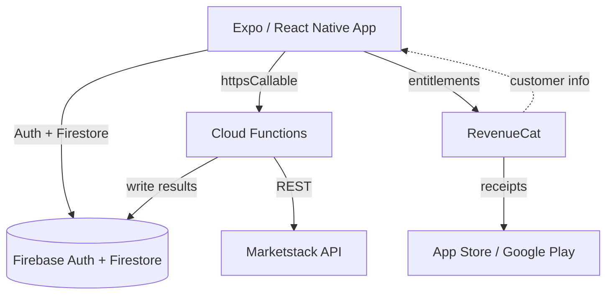

# BiasGuard

<p align="center">
  
</p>

> A behavioral-risk copilot for retail investors — spot the biases behind your portfolio decisions.

Built for **Shipathon 2026**.


BiasGuard turns portfolio and transaction history into two things:

1. **Risk metrics** — volatility, Sharpe ratio, max drawdown and beta, computed from aligned daily prices.
2. **Behavioral signals** — the disposition effect, loss-realization reluctance, overconfidence calibration, and confirmation / selective exposure.

The result is shown as a radar-style dashboard with plain-language explanations, so a user can see *why* a decision felt risky — not just a single score.

## Features

- **Portfolio management** — multiple portfolios, holdings and transaction history
- **Risk engine** — daily returns, volatility, Sharpe ratio, max drawdown and beta
  against a benchmark, with graceful handling of missing or unadjusted prices
- **Behavioral signals**
  - Disposition effect (PGR − PLR)
  - Loss-realization reluctance
  - Overconfidence calibration
  - Confirmation bias / selective exposure
- **Behavioral dashboard** — radar chart with data-sufficiency gating
- **Assessments & explanations** — guided questions with an explanation screen
- **Market data** — Firebase Cloud Function proxy for Marketstack EOD / historical prices
- **Premium** — RevenueCat paywall and entitlement sync
- **Account deletion** — server-side deletion flow with retries

## Architecture



- Market data is fetched **only** through Cloud Functions, so the Marketstack key never reaches the client.
- `MARKET_DATA_MODE` switches between the mock provider (development) and the cloud provider (production).

## Tech stack

| Layer | Stack |
|---|---|
| App | Expo SDK 57, React Native 0.86, Expo Router, TypeScript |
| Auth / DB | Firebase Auth, Firestore (security rules in `firebase/`) |
| Backend | Firebase Cloud Functions (Node.js 20), Marketstack |
| Billing | RevenueCat (`react-native-purchases`) |
| Charts | `react-native-svg` |
| Testing | Jest + ts-jest (frontend), Jest (functions) |

## Getting started

### Prerequisites

- Node.js 20+
- Expo CLI (`npx expo`)
- A Firebase project with Auth + Firestore enabled
- A RevenueCat project (for paywall testing)

### 1. Install

```bash
npm install
npm --prefix functions install
```

### 2. Configure

```bash
cp .env.example .env
```

Fill in the Firebase web app config and RevenueCat public SDK keys:

```bash
EXPO_PUBLIC_FIREBASE_API_KEY=
EXPO_PUBLIC_FIREBASE_AUTH_DOMAIN=
EXPO_PUBLIC_FIREBASE_PROJECT_ID=
EXPO_PUBLIC_FIREBASE_STORAGE_BUCKET=
EXPO_PUBLIC_FIREBASE_MESSAGING_SENDER_ID=
EXPO_PUBLIC_FIREBASE_APP_ID=

EXPO_PUBLIC_REVENUECAT_IOS_API_KEY=
EXPO_PUBLIC_REVENUECAT_ANDROID_API_KEY=
```

Server-side secrets (Marketstack key, RevenueCat secret) belong in Cloud Functions
config — never in the client `.env`.

### 3. Run

```bash
npx expo start
# i = iOS simulator, a = Android emulator, w = web
```

### 4. Deploy Firebase

```bash
firebase deploy --only firestore:rules,functions
```

`firebase.json` runs `npm --prefix functions run build` before deploying functions,
so the compiled `functions/lib/` output is generated at deploy time (not committed).

## Testing

```bash
npx jest                  # frontend: risk, behavior engines, schema, gates
npm --prefix functions test   # backend: market data, deletion
npm run lint              # expo lint
```

## Project structure

```
src/
├── app/                  # Expo Router screens
│   ├── (auth)/           # login / signup
│   ├── (app)/            # dashboard, portfolios, behavior, paywall
│   └── _layout.tsx
├── components/
│   ├── auth/             # shared auth screen
│   └── holdings/         # shared new/edit holding form
├── services/
│   ├── risk/             # volatility, Sharpe, drawdown, beta
│   ├── behavior/         # disposition, overconfidence, selective exposure
│   └── marketData/       # mock + cloud providers
├── repositories/         # Firestore data access
├── features/behavior/    # signal → dashboard mapping
├── types/                # domain models
└── config/               # Firebase, env

functions/
├── src/                  # Cloud Functions (TypeScript)
└── __tests__/            # backend tests

__tests__/                # frontend unit tests
firebase/                 # Firestore rules & indexes
```

## Security notes

- Firestore access is restricted to the authenticated owner via security rules.
- The Marketstack API key is only used inside Cloud Functions.
- The client `EXPO_PUBLIC_*` values are public by design; backend secrets stay server-side.
