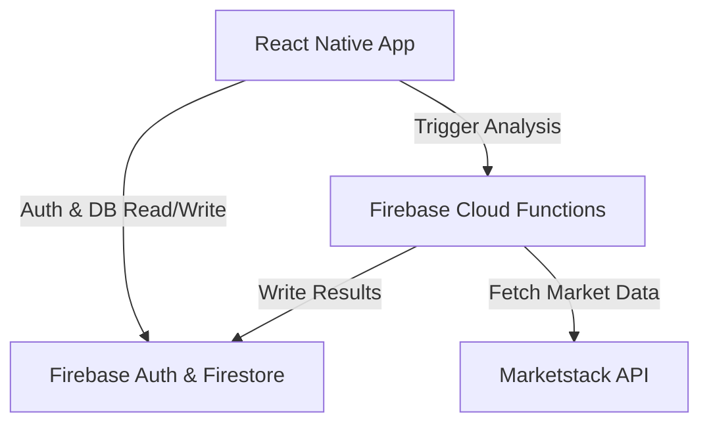
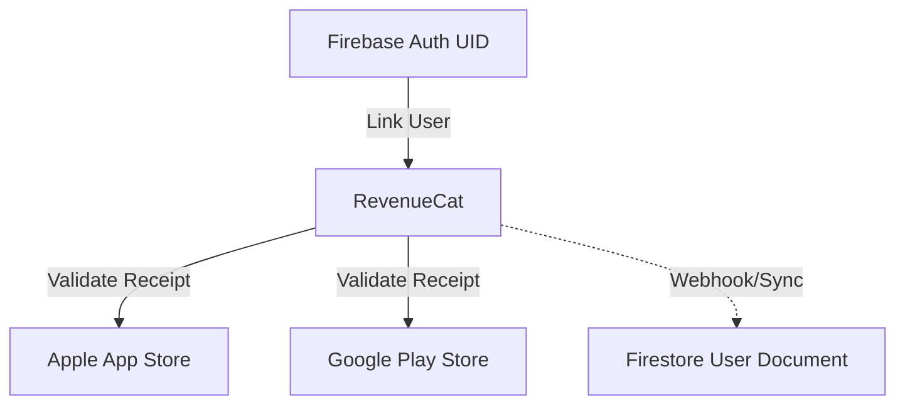

# BiasGuard

BiasGuard is an innovative mobile application designed to identify, analyze, and mitigate cognitive and behavioral biases in investment decision-making. Built for Shipathon 2026, it empowers users with actionable insights using an advanced Risk/Behavioral methodology.

## Overview & Methodology

### BiasGuard Concept
In today's fast-paced environment, unconscious biases—such as confirmation bias, overconfidence, and loss aversion—can subtly influence financial decisions. BiasGuard acts as a real-time copilot. By analyzing portfolio decisions and behavioral assessments, it highlights potentially risk-prone behaviors and helps users better understand their own decision-making processes.

### Risk/Behavioral Methodology
Our approach is grounded in behavioral economics and risk assessment models. The analysis engine evaluates input against:
- **Behavioral Assessments:** Using psychological heuristics to identify potential cognitive biases (e.g., anchoring, herd behavior).
- **Risk Assessment:** Scoring portfolio data on a risk scale to provide a quantifiable metric of decision quality using historical End-of-Day pricing.

## Architecture

BiasGuard leverages a modern, serverless stack. 

### Core Application Flow
The frontend is built with React Native (Expo) and communicates with Firebase for authentication and database services. Cloud Functions handle the heavy lifting, including interacting with external APIs like Marketstack for financial data.



### Monetization & Subscription Flow
We use RevenueCat to handle premium subscriptions seamlessly across platforms. The user's identity is linked between Firebase and RevenueCat to ensure consistent access to premium features.



## Local Setup

### Prerequisites
- Node.js 20+
- Expo CLI
- iOS Simulator or Android Emulator (or a physical device with Expo Go)

### Installation
1. **Clone & Install Dependencies:**
   ```bash
   npm install
   cd functions && npm install && cd ..
   ```

2. **Environment Configuration:**
   Copy the example environment file and fill in your keys. **Never commit actual API keys or secrets.**
   ```bash
   cp .env.example .env
   ```
   *Ensure you have your Firebase config and RevenueCat public keys configured in `.env`. WARNING: Never place backend secrets (e.g., Marketstack API keys or RevenueCat secret keys) in the client-side `.env` file, as they will be exposed.*

3. **Start the Application:**
   ```bash
   npx expo start
   ```
   Press `i` for iOS Simulator or `a` for Android Emulator.

## Testing & Validation
- **Frontend Tests:** Currently no automated frontend tests configured in `package.json`. Use `npx jest` if configured later.
- **Backend Tests:** `cd functions && npm test`
- **Release Validation:** Run `node ./scripts/validate-release.js` to ensure the build is ready, tests pass, and no secrets are committed.

## Integrations

- **Firebase:** Handles user authentication (email/password, social), stores analysis history in Firestore, and hosts serverless Cloud Functions.
- **RevenueCat:** Manages the paywall, subscription states, and cross-platform entitlements using the `react-native-purchases` SDK.
- **Marketstack:** Provides End-of-Day (EOD) and historical market data to contextualize financial risk assessments within the behavioral engine.

## Directory Structure
- `app/`: Expo Router screen definitions.
- `src/`: Core application logic (config, types, schema, repositories).
- `functions/`: Firebase Cloud Functions for backend processing.
- `scripts/`: Utility scripts (e.g., release validation).
- `docs/`: Runbooks, audit logs, and testing documentation.
- `firebase/`: Firestore Security Rules and Indexes.

---
*Developed for Shipathon 2026.*
