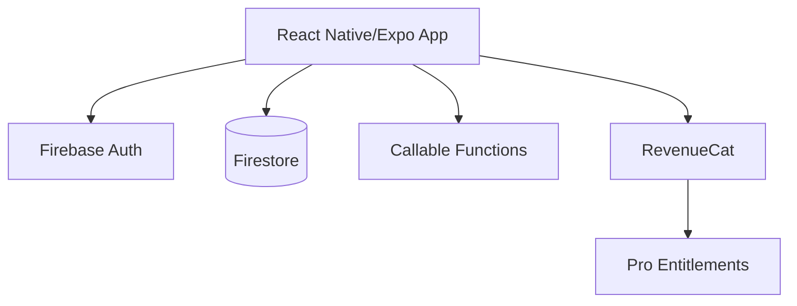
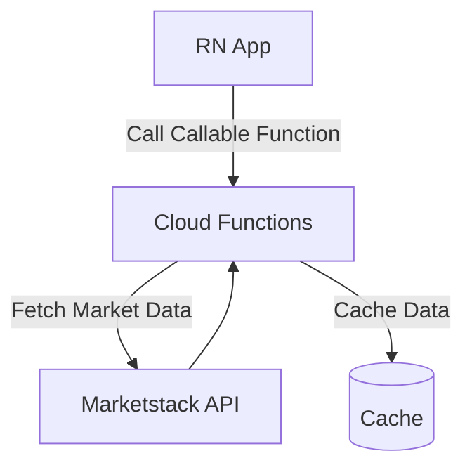
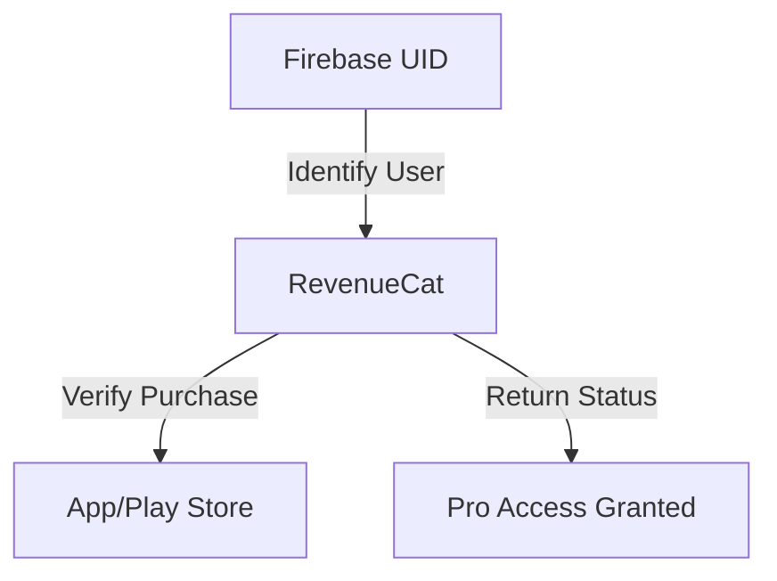
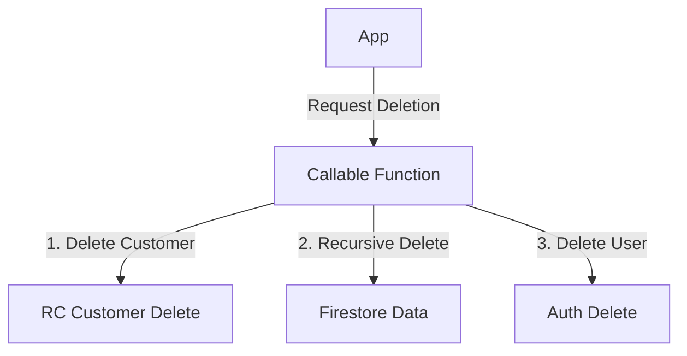

# Architecture Overview

## System Architecture

## Data Fetching Flow

## Subscription Flow

## Account Deletion Flow
*Note: This is not an atomic transaction. Failures mid-flight require manual or scheduled cleanup.*

